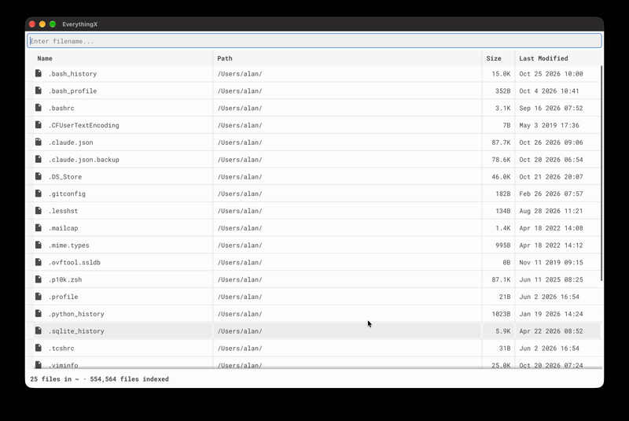
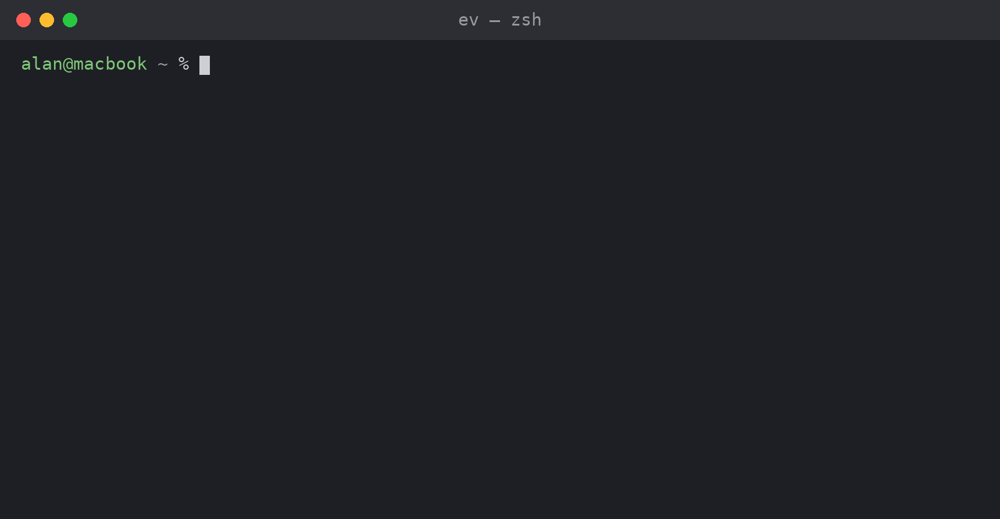

#  EverythingX

EverythingX is a fast file name search tool for macOS and Linux.

It started as an attempt to get [Everything by Voidtools](https://www.voidtools.com/support/everything/) on a Mac. A background service watches the filesystem and keeps an index up to date without rescanning the disk. You search it from a GUI app or from the command line, and results show up as you type.

Compared to Spotlight, `locate` and `find`, it's quicker to index, it picks up changes as they happen, it stays light on CPU and memory, and it starts instantly.

| GUI app | Command line |
|---|---|
|  |  |

There are three binaries:

- `everythingxd`: the background daemon that watches for file changes
- `everythingx`: the GUI app
- `ev`: the command-line search

## Command line
`ev` searches the index from the command line. It's much faster than `find`, and you can pipe the output into `grep` or anything else.

### Usage
```
ev search_term [-b] [-u] [-x]

-b bold search term in the result. This option helps readability of the output but interferes with piping results to another command.
-u show only results in the current user's home directory ($HOME).
-x show only executable files (regular files, or symlinks to them, with any execute bit set). Each result is checked on disk, so this is slower for terms with many matches.
```

```
ev -ux build
/home/alan/bin/build.sh
```

```
ev bashrc
/private/etc/bashrc
/private/etc/bashrc_Apple_Terminal
/home/alan/.bashrc
```

## GUI app
`everythingx` shows full paths and file details as you type. Columns sort and resize, and right-clicking a result lets you reveal it or copy its name, path or folder.

## Background service
`everythingxd` gets file change events from the kernel: FSEvents on macOS, and fanotify on Linux (needs root and kernel 5.9+). It also does an occasional full scan to catch anything it missed.

## Installation

Pick your platform. Each recommended method also handles upgrades.

| Platform | Recommended |
|---|---|
| macOS (Apple Silicon and Intel) | [Homebrew](#macos-homebrew) |
| Debian, Ubuntu and derivatives | [apt](#debian--ubuntu-apt) |
| Fedora, RHEL, openSUSE and derivatives | [Install script](#fedora--rhel--opensuse-install-script) |

**Supported platforms:** macOS (Apple Silicon and Intel) and mainstream glibc
Linux with `systemd`, on `x86_64` and `arm64`. Alpine/musl is not supported.

### macOS: Homebrew

```bash
brew install --cask alankk/everythingx/everythingx
```

`brew upgrade` picks up new releases. `brew uninstall --cask everythingx` stops the
daemon and removes the app and binaries; add `--zap` to also delete the index in
`/var/lib/everythingx` and the log.

**Full Disk Access:** however you install on macOS, grant Full Disk Access to
`everythingxd` in `System Settings -> Privacy & Security -> Full Disk Access` for
complete indexing. This has to be done by hand.

### Debian / Ubuntu: apt

```bash
sudo install -d -m 0755 /etc/apt/keyrings
curl -fsSL https://alankk.github.io/everythingx/everythingx.gpg | sudo tee /etc/apt/keyrings/everythingx.gpg >/dev/null
echo "deb [arch=$(dpkg --print-architecture) signed-by=/etc/apt/keyrings/everythingx.gpg] https://alankk.github.io/everythingx stable main" | sudo tee /etc/apt/sources.list.d/everythingx.list
sudo apt update && sudo apt install everythingx
```

`apt upgrade` picks up new releases. The repo covers amd64 and arm64 and keeps the five
newest versions; for anything older, use the manual download below.

### Fedora / RHEL / openSUSE: install script

There's no dnf/zypper repository yet, so use the install script. It also works on
macOS. It detects your OS and CPU, downloads the matching native package from the
latest [release](https://github.com/AlanKK/everythingx/releases/latest), and installs
it. On Debian/Ubuntu it sets up the [apt repository](#debian--ubuntu-apt) instead:

```bash
curl -fsSL https://raw.githubusercontent.com/AlanKK/everythingx/main/install.sh | sudo sh
```

Pin a specific version:

```bash
curl -fsSL https://raw.githubusercontent.com/AlanKK/everythingx/main/install.sh | sudo EVERYTHINGX_VERSION=v1.0.0 sh
```

Re-run the script to upgrade (on Debian/Ubuntu, `apt upgrade` does it).

### Manual download

Prefer to install by hand? Grab the package for your platform from the
[Releases](https://github.com/AlanKK/everythingx/releases/latest) page:

| Platform | Package |
|---|---|
| macOS (Apple Silicon) | `EverythingX_macos-apple-arm64.pkg` |
| macOS (Intel) | `EverythingX_macos-intel-amd64.pkg` |
| Linux x86_64 (Debian/Ubuntu) | `everythingx_linux_amd64.deb` |
| Linux x86_64 (Fedora/RHEL) | `everythingx_linux_amd64.rpm` |
| Linux arm64 (Debian/Ubuntu) | `everythingx_linux_arm64.deb` |
| Linux arm64 (Fedora/RHEL) | `everythingx_linux_arm64.rpm` |

**macOS:** double-click the `.pkg` file to install, then grant Full Disk Access as
described above.

**Linux:**
```bash
# Debian/Ubuntu
sudo dpkg -i everythingx_linux_*.deb

# Fedora/RHEL
sudo dnf install ./everythingx_linux_*.rpm
```

### Linux notes

The daemon requires root for fanotify (kernel 5.9+). The data directory `/var/lib/everythingx/` is created automatically. The GUI needs libGL/X libraries at runtime; on a minimal/headless server the `everythingxd` daemon and `ev` CLI still work without them.

## Running locally without installing
```bash
make build

# Start the daemon
sudo bin/everythingxd

# Search from CLI
bin/ev -b filename

# Launch GUI
bin/everythingx
```

## Building from source

### Prerequisites
- Go 1.27.3+
- CGO toolchain (Xcode CLT on macOS; `gcc` on Linux)
- **Linux GUI**: `sudo apt-get install libgl1-mesa-dev xorg-dev libwayland-dev libxkbcommon-dev` (the Wayland headers are needed even on X11-only or headless systems; the daemon and CLI build without any of these)
- **macOS app bundle**: `go install fyne.io/fyne/v2/cmd/fyne@latest`
- **Linux packages**: `go install github.com/goreleaser/nfpm/v2/cmd/nfpm@latest`

### Build commands
```bash
make build    # Build all binaries into bin/
make test     # Run unit tests
make app      # Package EverythingX.app (macOS only)
make deb      # Build .deb package (Linux only)
make rpm      # Build .rpm package (Linux only)
make clean    # Remove build artifacts
```

## License
EverythingX is licensed under the Expat License (commonly known as the MIT License). See the [LICENSE.txt](LICENSE.txt) file for more information.

## Contact, feature requests, and bug reports
Create an issue on the [Github Page](https://github.com/AlanKK/everythingx/issues)
